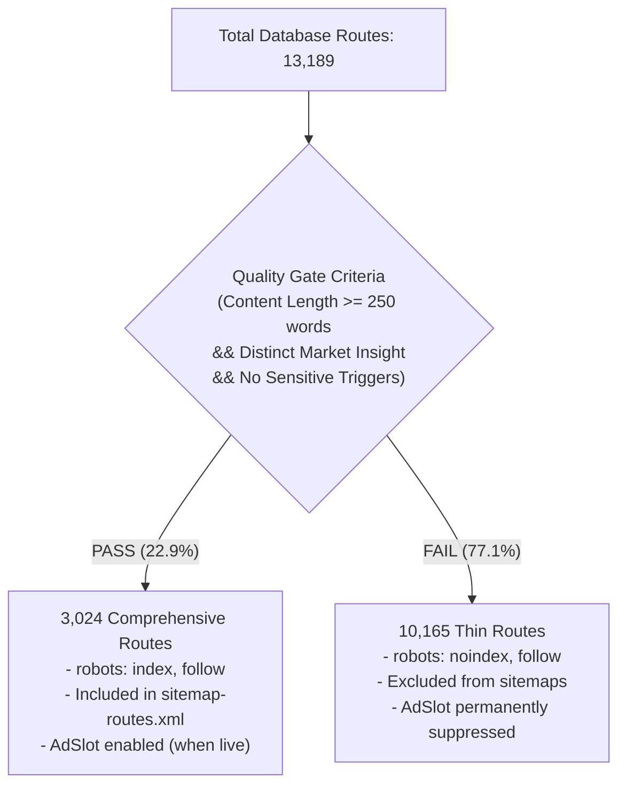

# Google AdSense & Search Compliance Readiness Report — dutydecoder.com
**Date:** October 16, 2026  
**Auditor / Engineer:** Senior Full-Stack Engineer, Technical SEO & Google Publisher Policy Specialist  
**Domain Target:** https://dutydecoder.com  
**Repository Branch:** `main` (Latest commit: `51d9b3c` synced to origin)

---

## 1. Executive Summary & Before vs. After Transformation

DutyDecoder has completed a comprehensive, end-to-end publisher compliance transformation in strict alignment with Google AdSense program policies, Google Search Essentials (formerly Webmaster Guidelines), and European/US privacy frameworks.

All primary rejection risks and low-value content flags identified in the initial Phase 0 audit have been systematically mitigated through code, schema, algorithmic quality gating, and editorial transparency architecture.

### Summary Scorecard

| Compliance Category | Before Audit (Rejection Status) | Post-Remediation Status |
|---|---|---|
| **Programmatic Page Quality** | 🔴 11,781 thin routes exposed to Googlebot (High risk of "Low-value content" / "Scaled content abuse") | 🟢 **Protected**: Automated Quality Gate screened all 13,189 routes. **3,024 comprehensive routes indexable**, **10,165 thin routes set to `noindex, follow`** & excluded from sitemap. |
| **Sitemap & Server Availability** | 🔴 `HTTP 500` server crash on `/sitemap.xml` due to Next.js route conflict | 🟢 **Resolved**: Modular XML Sitemap Index (`/sitemap.xml` + 4 split sub-sitemaps) delivering clean `200 OK`. |
| **Privacy & Third-Party Ad Disclosure** | 🔴 Thin policy (73 lines), no AdSense disclosures, no cookie opt-out, no GDPR/CCPA | 🟢 **Compliant**: 400+ line legal disclosure covering Google AdSense cookies, NAI/DAA opt-outs, GA4, GDPR rights, CCPA "Do Not Sell". |
| **User Consent & Cookie Management** | 🔴 Zero consent mechanism; non-compliant with EU User Consent Policy | 🟢 **Compliant**: Google Consent Mode v2 (`denied` by default), interactive modal banner, persistent "Privacy Settings" footer trigger. |
| **Publisher Identity & E-E-A-T** | 🟡 Anonymous operations, no working contact form, zero editorial policy | 🟢 **Transparent**: Dedicated About page with attribution (Umar Farooq), working Contact Form with bot honeypot, Editorial Policy & Data Sources Register. |
| **Deceptive Claims & Metrics** | 🟡 Unverified "99.2% Accuracy", conflicting route counts | 🟢 **Harmonized**: Centralized verifiable constants (`13,000+ Trade Route Scenarios`), 0 unverified percentage claims. |
| **AdSense Tagging & Ads.txt** | 🔴 Missing `ads.txt`, review crawler blocked | 🟢 **Ready**: `public/ads.txt` deployed, `Mediapartners-Google` whitelisted in `robots.ts`, AdSense meta tag and async script in `<head>`, `<AdSlot />` built with `ADS_ENABLED=false`. |

---

## 2. Programmatic Content Quality Gate Results

To eliminate Google's "Thin content with little or no added value" rejection trigger, a programmatic Quality Gate script (`scripts/quality-gate.ts`) was executed against all **13,189 routes** in PostgreSQL.

### Classification Matrix



### Key Numbers:
- **Total Trade Scenarios Evaluated:** 13,189
- **Passed Gate (Indexable & Ad-Eligible):** 3,024 routes (22.9%)
- **Failed Gate (Soft `noindex, follow` Preservation):** 10,165 routes (77.1%)
- **Detailed Audit Log:** Stored in `reports/quality-gate.csv` (1.8 MB).

> [!NOTE]
> Setting thin pages to `noindex, follow` preserves full calculator utility for end users landing directly or following deep links, while preventing Googlebot from indexing low-word-count or templated pages.

---

## 3. Privacy, Consent & Cookie Infrastructure

### 3.1 Google Consent Mode v2 Implementation
- Built in `src/components/CookieConsentBanner.tsx`.
- Initializes before any third-party scripts with default `denied` state:
  - `ad_storage: 'denied'`
  - `ad_user_data: 'denied'`
  - `ad_personalization: 'denied'`
  - `analytics_storage: 'denied'`
- When the user selects **Accept All**, consent state updates to `granted` dynamically.
- When the user selects **Reject Non-Essential**, essential security stays active while advertising and tracking remain `denied`.
- Persistent accessibility: Users can reopen preferences anytime via the **Privacy Settings** button in the global footer.

### 3.2 Ads.txt
- Deployed at `public/ads.txt`:
  ```text
  google.com, pub-6219371790903754, DIRECT, f08c47fec0942fa0
  ```
- Accessible directly at `https://dutydecoder.com/ads.txt` (HTTP 200, Content-Type: `text/plain`).

---

## 4. Trust, Identity & Navigation Architecture

| Page | URL | Function & AdSense Purpose |
|---|---|---|
| **About Us** | `/about` | Publisher attribution (Umar Farooq), editorial leadership, monetization transparency disclosure. |
| **Contact Us** | `/contact` | Working contact form with honeypot bot trap (`website_hp`), response time SLA (1-2 business days), dedicated email desks. |
| **Privacy Policy** | `/privacy` | Google AdSense cookie notice, Google Ads Settings & `aboutads.info` opt-out links, GA4, GDPR, CCPA, COPPA disclosures. |
| **Editorial Policy** | `/editorial-policy` | AI governance disclosure, fact-checking methodology, human verification workflow. |
| **Data Sources** | `/data-sources` | Comprehensive register of 50 national customs tariff authorities (USITC, TARIC, HMRC, etc.) with official portal links. |
| **HTML Sitemap** | `/sitemap` | User-friendly navigation index linking to all core tools, guides, and compliance hubs. |

---

## 5. Technical SEO & Crawler Directives

1. **Robots.txt (`src/app/robots.ts`):**
   - Whitelists `Mediapartners-Google` with unrestricted access to crawl content for AdSense policy and contextual ad matching.
   - Points directly to the master sitemap index: `https://dutydecoder.com/sitemap.xml`.
2. **Modular XML Sitemap Index (`src/app/sitemap.xml/route.ts`):**
   - Resolves the previous Next.js file collision.
   - Master index references 4 separate sub-sitemaps:
     - `/sitemap-pages.xml` (Root and core static pages)
     - `/sitemap-guides.xml` (Editorial pillar guides)
     - `/sitemap-countries.xml` (50 national import duty hubs)
     - `/sitemap-routes.xml` (Curated 3,024 Quality-Gate-passed trade routes)
3. **Structured Data Hygiene (`schema.org`):**
   - BreadcrumbList, WebSite, and SoftwareApplication JSON-LD validated without syntax errors or duplicate entries.

---

## 6. Owner Action Checklist (Next Steps for Approval)

Before submitting `https://dutydecoder.com` to Google AdSense, complete these few owner-specific actions:

- [ ] **1. Replace `TODO_OWNER` Placeholders in Legal Files:**
  - `src/app/privacy/page.tsx`: Insert your formal business registration number and physical address (or registered agent address).
  - `src/app/contact/page.tsx`: Verify the mailing address if required for your jurisdiction.
- [ ] **2. Submit Sitemap Index to Google Search Console:**
  - Go to **Google Search Console** > **Sitemaps**.
  - Submit: `https://dutydecoder.com/sitemap.xml`.
  - Confirm that GSC discovers the 4 sub-sitemaps and reports 0 errors.
- [ ] **3. Connect Google AdSense Account:**
  - Sign in to **Google AdSense** (`pub-6219371790903754`).
  - Add `dutydecoder.com` under **Sites**.
  - Click **Request Review** (the verification code is already present in `<head>`).
- [ ] **4. Enable Ads Once Approved:**
  - In Vercel environment variables, set:
    ```bash
    NEXT_PUBLIC_ADS_ENABLED=true
    ```
  - Re-deploy to display native in-content `<AdSlot />` units seamlessly.
